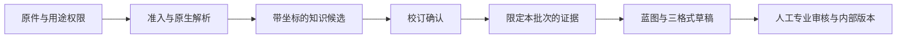

# vertical-knowledge-ai · 垂类知识AI系统

**将有使用权限的专业资料，转化为可追溯、可审核、可交付的知识与教学成果。**

本项目提供垂类AI系统的配置方法、八板块设计与可运行的本地实现。流程覆盖资料准入、原文解析、知识校订、证据检索、内容蓝图、成果导出、审核发布、版本血缘及审计恢复。首期以青少年体能知识库和48课时课程验证业务链路，足球专项和运动康复后置。

当前为**单机本地首版**：Python 3.11+，仅标准库，SQLite与受管文件存储。默认extractive规则编排，无模型下载、API密钥或付费调用要求；没有训练自有基础模型。模型适配接口的测试不代表真实模型效果。

## 新克隆后一条命令跑通

```powershell
git clone https://github.com/hanmeimei666/vertical-knowledge-ai.git
cd vertical-knowledge-ai
python scripts/smoke_import.py
```

私有仓库需使用有权限的GitHub账号克隆。脚本使用仓库原创演示文本，在`data/smoke/<uuid>/`建立全新运行目录；每次隔离运行，不覆盖已有资料，不需要原有私有DOCX或模型，不修改主运行库。



输出包含status=PASS、run_state=draft_ready及Markdown/HTML/JSON完整路径，打开lesson.html即可查看。演示仅自动确认**这份已知原创测试文本**，不自动批准真实资料或专业结论。

## 后续真实知识资源的固定入口

**[真实知识资源导入指南](docs/真实知识资源导入指南.md)** · [最新导入验收记录](docs/资源导入验收记录.md)

将文件放在本地`data/raw/incoming/`，复制[准入模板](config/import_manifest.example.json)为`data/my-source.json`，按真实依据填写来源、敏感性和六项权限，然后执行：

```powershell
python scripts/import_resources.py prepare --manifest data/my-source.json --batch resource-001
# 编辑data/imports/resource-001/candidates.json：
# include=true，校订标题、主题词、教学用法和限制，确认后confirmed=true
python scripts/import_resources.py commit --batch resource-001 --goal '本次教研主题' --key resource-001-v1
```

支持原生DOCX及UTF-8 TXT/MD；PDF、扫描图片和音视频当前不自动解析。未知权限/敏感资料隔离，无证据停止；候选不是自动审定知识。生产仅用本批次确认项，避免旧库内容代替新资源。来源或权限改变后重新准备和校订，旧源版本不静默沿用。

|使用目的|入口|
|---|---|
|看系统功能和实现位置|[总设计与八板块文档](docs/系统流程设计与实现.md)|
|验证干净环境|`python scripts/smoke_import.py`|
|准备真实资料|[导入指南](docs/真实知识资源导入指南.md)|
|手工整理多来源知识|[知识单元模板](config/knowledge_unit.example.json)，`workflow.py add-unit`|
|了解模型、API、审核和恢复|[模型配置](docs/design/05_模型配置与蓝图.md) · [审核](docs/design/07_审核发布与血缘.md) · [运维](docs/design/08_服务评测与运维.md)|

## 系统设计与运行入口

- **[总流程、22项需求追踪和八板块设计](docs/系统流程设计与实现.md)**
- [本轮实现与验收报告](docs/系统流程实现验收报告.md)
- [运行配置](config/runtime.json) · [领域规则](config/domain_rules.json) · [资料准入模板](config/import_manifest.example.json)

已实现本机SQLite目录、原生资料准入、六项用途权限、证据包、规则蓝图、持久流程、三种导出、人工审核门禁、内部发布、来源撤回失效、审计、备份和鉴权只读API。默认不调用模型；Ollama/OpenAI适配接口通过契约测试，真实模型尚未验证。仅限单机可信写入操作者，非公网生产服务。

```powershell
Set-Location 'D:\gptproject\vertical-knowledge-ai'
python scripts/workflow.py seed
python scripts/workflow.py search '成熟度'
python scripts/workflow.py run '蹲与髋铰链的教学观察' --key my-first-draft
python scripts/workflow.py status
python scripts/evaluate.py
python -m unittest discover -s tests -v
```

成果路径和run_id由命令返回；审核人默认未配置，真实课程停在待审。上面seed/run用于现有青少年体能母版，克隆不含私有DOCX时关联来源隔离；无私有文件验证请用smoke_import。seed可能重新纳入编辑知识卡，不作为日常新资料导入入口。data/outputs及实际原件、解析、运行库不会提交Git。

## 目录、验证和扩展

|目录|职责|
|---|---|
|config/|运行/领域规则、准入和知识模板、评测集|
|docs/|总流程、八板块设计、操作指南与验收|
|scripts/、tests/|导入、生产、模型适配、服务和自动检查|
|examples/resources/|可分享的原创流程演示资源|
|knowledge/、courses/|编辑知识与首个业务课程资产|
|data/、outputs/|本地原件/候选/运行库/成果/备份，全部默认Git忽略|

```powershell
python scripts/check_readiness.py
python -m unittest discover -s tests -v
python scripts/smoke_import.py
python scripts/knowledge.py verify
# 主库已seed并具备相应合法资源时执行业务检索开发回归
python scripts/evaluate.py
python scripts/workflow.py backup
```

2026-11-15：40项自动测试通过，含10项新资源导入测试；干净目录从新文本到三格式草稿通过。12题原业务开发回归为相关10/10 Hit@3、无证据2/2，不是独立盲测或专业准确率。最新证据见导入验收记录。

后续按实际样本验证后扩展OCR/ASR、视频、向量/混合检索、真实模型、其他领域和部署。当前没有公网多用户服务、生产级多人RBAC、完整学习平台、自动处方或设备控制；已导出静态副本无法远程撤销。源资料再分发、训练和云处理按各项用途管理；当前未指定代码开源许可证。

## 首个业务样本

首期优先构建青少年体能知识库及课程，足球和运动康复后置。课程采用用户要求的40–60课时范围内的 **48课时**：24次课，每次2课时；1课时45分钟，共36小时；理论18、实践/案例30。

这是面向成年体育教师与教练的独立核心课程。原150/200学时文件保留，不自动宣称新版等同于原等级培训或资格认定。

## 先看成果

- [48课时课程与24次课教案](courses/youth-conditioning/青少年体能训练核心课程_48课时.md)
- [原大纲调整与30项任务去向](courses/youth-conditioning/原大纲调整与任务映射.md)
- [32张带来源知识卡](knowledge/youth-conditioning/知识卡.md)
- [12条国际资料与2份本地母版来源目录](knowledge/youth-conditioning/来源目录.md)
- [首份90分钟样本教案：蹲与髋铰链](courses/youth-conditioning/L10_首份样本教案.md)
- [7份表单与八周模拟计划](courses/youth-conditioning/实训表单与八周示例.md)
- [12道情境题与评分要点](courses/youth-conditioning/情境题与评分要点.md)
- [建设与验证报告](docs/青少年体能知识库_首轮建设报告.md)

## 运行

Python 3.11+；已实现部分只用标准库，不需要安装向量库、模型或服务。

```powershell
Set-Location 'D:\gptproject\vertical-knowledge-ai'
python scripts/knowledge.py search '成熟度'
python scripts/knowledge.py search '损伤预测' --limit 3
python scripts/knowledge.py lesson L10
python scripts/knowledge.py verify
python -m unittest discover -s tests -v
```

`knowledge.py`是前轮只读编辑资产检查脚本；检索是中文双字片段/英文关键词匹配，没有自由生成问答或语义模型。它直接读取编辑JSON，不执行运行库的撤回/准入状态。**实际生产和知识服务使用workflow.py/serve.py**，由运行库执行权限和版本过滤。无候选返回 `no_evidence`；关键词结果仍需结合限制核查。

## 原始样本与复现

首轮样本目录：`D:\gptproject\vertical-knowledge-ai\data\raw\youth-conditioning`。
内含用户提供的《青少年体能训练师》岗位技能标准和教学实施方案DOCX副本。原件未修改，副本和全文解析结果默认不上传GitHub。

```powershell
python scripts/ingest_outline.py
python scripts/render_course.py
python scripts/knowledge.py verify
```

`ingest_outline.py`需要本地样本；远端克隆不含原始DOCX。渲染、检索和结构验证可仅依赖仓库内的原创归纳/配置；源指纹与合法结构坐标见 `knowledge/youth-conditioning/local_source_index.json`。本地存在原件时校验指纹，不能把结构验证当成逐条专业正确性审核。

## 当前交付边界

课程资产已实现：DOCX原生结构提取、源指纹、32卡编辑基线检索、24课结构化数据、Markdown渲染与验证。系统运行实现见前述总流程与验收报告。
已完成初稿：课程讲解要点、活动、作业、评价、表单、样本教案。
待验证：专家签审、动作示范复核、真实班级试教、学习效果与正式运营规则。
未建设：视频、自动处方、康复、足球专项、微调、云部署和实时设备功能。

国际资料只保留原创中文归纳、出处和核查状态；摘要/索引与全文核查分开记录。课程不得标记为已经专业审定或已验证有效。
