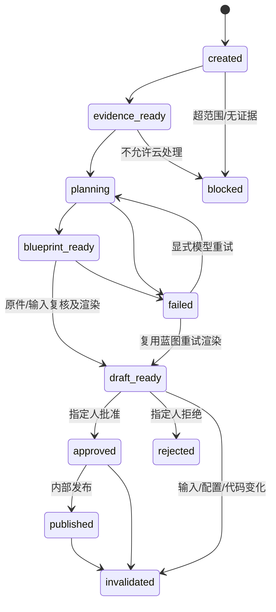

# B06 执行、检查点与导出

## 状态机



任意适用状态的源/知识更新均可进入invalidated；blocked/rejected/invalidated不原地升级，修订后使用新key生成新run。

## WorkflowRun与幂等

运行时生成UUID run_id；request_key唯一、request_hash固定请求；input_hash绑定目录、配置、领域规则与实现代码。snapshot保存配置、领域规则和提示版本；steps保存证据包、蓝图和成果哈希。state/error与audit可追踪中断点。

`start`重复key不会再次生产；失败后需`resume`。渲染失败但蓝图已保存时，恢复只重新渲染，不再次调用模型。网络请求发出之前先保存尝试记录；有不确定结果的模型尝试不能自动重放。并发调度和多Worker尚未实现，部署时限定单写者。

```powershell
python scripts/workflow.py run '成熟度与分组的教学' --key draft-maturity-v1
python scripts/workflow.py inspect <run-id>
python scripts/workflow.py resume <run-id>
# 只有明确接受可能重复请求/费用时才使用
python scripts/workflow.py resume <run-id> --retry-model
```

## 成果契约

|文件|用途|质量检查|
|---|---|---|
|lesson.md|可编辑教研文本|事实归纳、编排建议、边界、源ID/修订/坐标分列|
|lesson.html|独立打开、带来源链接的阅读页与临时教研记录输入框|HTML转义、无脚本、CSP、中文字符；输入框不持久保存|
|bundle.json|结构化交接/程序复用|证据包、蓝图、input_hash、run_id、review及stage|

目录为`outputs/workflow/<run-id>/draft/`，审核版本为`release/`。先写临时文件再替换，每个产物记录SHA-256。部分渲染失败不会升级draft_ready；受管获取、审核、发布前检查完整性。

HTML和Markdown中的用户/模型文字做转义，不把来源内容当脚本；模型没有控制模板、文件路径和可执行代码的权限。HTML只允许http/https来源链接，不自动下载外部素材。无图像/动作视频，不能冒称已验证动作示范。HTML提供阅读和临时填写，不是完整学习平台。

## 失败码与处理

|error/state|原因|动作|
|---|---|---|
|blocked/no_evidence|无符合权限及相关性门槛的知识|补充允许的资料/知识或改需求，新建key|
|blocked/out_of_scope_request|触发明确排除项|缩小为成人教研，不能绕过专业边界|
|blocked/external_processing_not_authorized|至少一个源不允许云处理|保留本地或真实补核授权后重建任务|
|failed/model_failed|请求/模型JSON/蓝图校验失败，或尝试中断|检查配置和原因，显式决定是否重试|
|failed/step_failed|文件/渲染等步骤失败|修复磁盘等环境，resume复用已存检查点|
|invalidated/input_revision_changed|输入、原件、配置、代码改变|保留旧记录，不复用旧审核；新建任务|

失败日志只保留类别，避免写密钥和敏感正文。需要深查时在本机查看SQLite步骤和实际环境，不将供应商错误响应直接复制到公共日志。

## 新产出扩展

新导出器接收已验证Blueprint和EvidencePack，返回路径/哈希/来源映射；不直接接收模型任意命令。视频需素材许可、源/成片时码、动作复核与可播放检查；PDF/DOCX需版式渲染验收；这些本轮均未实现。现有48课时完整课程由render_course.py维护，主题生产工作流不会自动覆盖整门课程。
