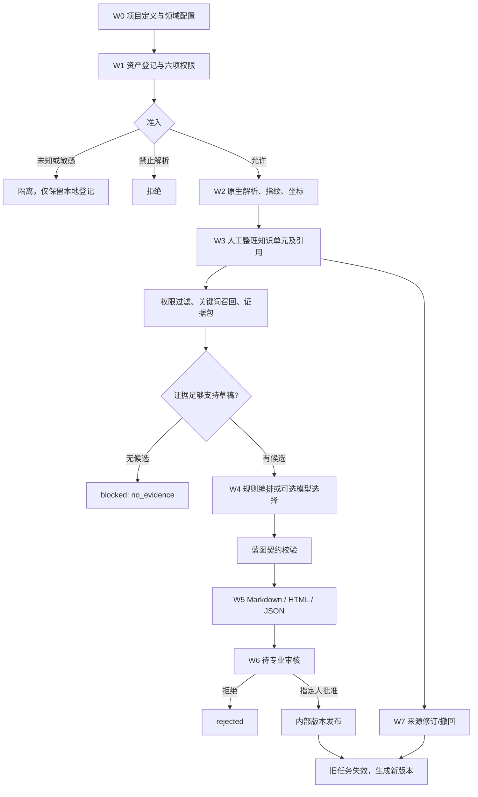

# 垂类知识大模型：配置流程与逐板块实现 V0.2

日期：2026-11-15。读者：项目负责人、开发人员和教研审核人。本文件是系统入口，课程资料是验证样本。

## 1. 本轮目标与验收定义

用户要求以启动包为依据设计并实现垂类大模型配置流程；优先青少年体能，足球和康复后置，课程40–60课时。本轮采用48课时业务资产验证系统，但系统主交付是可运行的知识生产链。

成功条件：从明确权限的实际资料和知识资产出发，经准入、证据检索、编排蓝图、成果渲染到待审核状态；在测试样本中跑通人工审核、内部发布和来源撤回；每一步有配置、数据契约、执行代码、错误行为及验收证据。没有模型时能运行，不把规则编排说成模型生成。

启动包明确其技术为可裁剪建议。本实现选择文档、静态HTML和只读API作为首轮交付；OCR/ASR、视频、微调、MCP、设备列为扩展设计，不冒称实现所有格式。没有重新训练基础模型，也没有实测真实云端/本地模型效果。

## 2. 总体流程



图中的“有候选”只通过技术门槛；系统会保留知识限制和覆盖缺口，最终专业适用性由审核人判断。

## 3. 八板块与实际实现

|板块|设计文档|代码/配置入口|本轮状态|
|---|---|---|---|
|B01 项目配置与任务边界|[01](design/01_项目配置与运行边界.md)|runtime.json、domain_rules.json、Pipeline.__init__/start|已实现并测试|
|B02 资产准入与权限|[02](design/02_资产准入与解析.md)|admit、parse_native、seed|原生DOCX/TXT/MD已实现；多媒体扩展设计|
|B03 知识结构与版本|[03](design/03_知识契约与版本.md)|add_unit、records/revisions|人工归纳入库与版本已实现；自动抽取待选型|
|B04 检索与证据|[04](design/04_检索与证据包.md)|evidence、evaluate.py|关键词基线已验证；向量/重排未启用|
|B05 模型配置与蓝图|[05](design/05_模型配置与蓝图.md)|model_adapter.py、resume|规则已验证；云端/本地适配完成契约测试，未接真实模型|
|B06 执行与多形态导出|[06](design/06_执行生产与导出.md)|start/resume/render、workflow.py|持久状态和三种草稿已验证；视频未实现|
|B07 审核、发布、审计|[07](design/07_审核发布与血缘.md)|review/publish/withdraw/artifact|测试数据闭环通过；实际课程仍待专业审核|
|B08 服务、评测、恢复|[08](design/08_服务评测与运维.md)|serve.py、evaluate.py、backup|本机只读鉴权API和恢复检查已测试；云部署未实现|

## 4. 启动包要求追踪表

|编号|手册位置/功能|实现或明确裁剪|验收方式|
|---|---|---|---|
|R01|§1 技术真实性|extractive标记规则；模型适配不称自研权重|status、bundle.blueprint.mode|
|R02|§3/7 权限分离|六项true/false/null；检索、改编、外发分别门禁|unknown_rights、retrieval_does_not_grant_adaptation、external_processing测试|
|R03|§7 资料准入|admitted/quarantined/rejected，敏感资料隔离|rights_false_reject_and_sensitive测试|
|R04|§8–9 原件和定位|SHA-256、DOCX B/R、文本L；版本绑定|real_course_and_source_coordinates、original_change测试|
|R05|§8 五级逻辑对象|L0资产、L1blocks、L2知识、L3教学应用、L4run/blueprint/artifact|03契约；真实bundle|
|R06|§10 原子化与原文区分|人工知识归纳，origin=curator_summary，limits与source refs保留|add_unit缺字段/坐标检查；输出分栏|
|R07|§11 检索证据|用途过滤→召回→版本/权限证据包；不自动消解冲突|12条检索回归；模型无证据不调用|
|R08|§12 模型可换|extractive/ollama/openai；快照模型名、参数、prompt版本、usage|HTTP本地替身与OpenAI响应契约测试|
|R09|§13 模型执行分权|模型只选已知ID；无工具执行；HTTP只读|hallucinated_blueprint、HTTP POST=405|
|R10|§13 状态与重试|SQLite检查点、幂等key、失败记录、显式模型重试|render_failure、model_failure、重复key测试|
|R11|§14 蓝图|request/units/limitations/review_required；校验知识ID白名单|validate_plan；bundle.json|
|R12|§14 实际多形态成果|Markdown、可填写临时教研记录的HTML、JSON、API|成果哈希、HTML转义、API读取|
|R13|§15 存储选择|受管文件+SQLite；索引可重建，资产修订不覆盖|版本表、源指纹、backup完整性|
|R14|§16 专业审核|指定本机审核人，未配置拒绝批准；公开发布不开放|unknown_reviewer、release测试|
|R15|§8/16 撤回与血缘|源/知识修订使旧任务失效；受管读取拒绝|withdrawal、unit_change、artifact完整性测试|
|R16|§17 分层评价|结构检查、权限负向、流程失败、检索回归、专业审核分开|测试套件与验收报告|
|R17|§18 W0–W7|映射八板块和操作顺序|以下运行步骤及08运维文档|
|R18|§23 体育首轮成品|已授权DOCX→知识→证据→蓝图→HTML/文档|首个真实run，课程48课时继续作为业务资产|
|R19|§6/9 OCR、ASR、视频|扩展接口设计，现有原生样本无需调用|02格式表；不支持格式明确拒绝，不伪造解析|
|R20|§14 设备与高风险控制|未计划；没有设备动作接口|只允许teaching_draft，领域排除项及服务只读|
|R21|§12 微调|未计划；须有独立训练权与锁定评测集|training权限不被其他权限推导|
|R22|§24 第二领域通用性|核心与领域配置分离；未做真实第二领域验证|不宣称已经跨领域验证|

## 5. 本地落地步骤

Python 3.11+，仅标准库。以下命令在项目根目录执行；第一次seed读取本地样本。Git克隆不含原始DOCX，缺失时当地来源隔离，其关联知识不供生产使用；恢复原件后按02文档重新admit。

```powershell
Set-Location 'D:\gptproject\vertical-knowledge-ai'
# 1. 准备和检查课程业务资产
python scripts/knowledge.py verify
# 2. 将现有来源/知识显式纳入系统
python scripts/workflow.py seed
python scripts/workflow.py status
# 3. 检索并查看证据包
python scripts/workflow.py search '成熟度'
# 4. 创建幂等生产任务（更改需求或来源后使用新的key）
python scripts/workflow.py run '蹲与髋铰链的教学观察' --key my-first-draft
# 5. 用上一步返回的id回查和获取成果路径
python scripts/workflow.py inspect <run-id>
python scripts/workflow.py artifact <run-id> lesson.html
# 6. 运行验收
python scripts/evaluate.py
python -m unittest discover -s tests -v
```

实际审核人未指定，所以本轮在draft_ready交付。不能为了通过演示而填写虚构专家姓名或批准真实课程。审核和内部发布的操作步骤在07；测试闭环使用明确标注的fixture身份。

## 6. 技术选择与未决项

|问题|简单方案|更复杂替代|本轮选择及触发条件|
|---|---|---|---|
|元数据与流程|SQLite+本地文件|PostgreSQL+对象存储+队列|当前小样本单机单写者；多人并发或长任务时迁移|
|检索|关键词+权限过滤|向量/混合+重排|先保存基线；同义查询系统性漏召且独立评测净收益明确再换|
|内容编排|规则复用已归纳知识|模型综合生成|按用户选择本地先跑；适配就绪，真实模型另做质量成本评测|
|执行|持久确定性流程|多Agent与后台Worker|当前链路不需要多Agent；大量异步媒体任务后再评估|
|交付|Markdown/HTML/JSON+只读API|视频/托管产品/MCP|先验证受控成果；有授权素材、发布渠道和预算才扩展|

未决项：真实专家与责任主体、上线用户权限体系、模型可用性和预算、原始国际来源完整许可、真实试教效果、备份保留政策。单机脚本的本机身份校验不是生产级多人RBAC；直接取得磁盘文件的人可绕过应用，已导出的副本无法远程撤销。

开发验收见[本轮报告](系统流程实现验收报告.md)。本轮无真实模型调用，无新付费服务。
